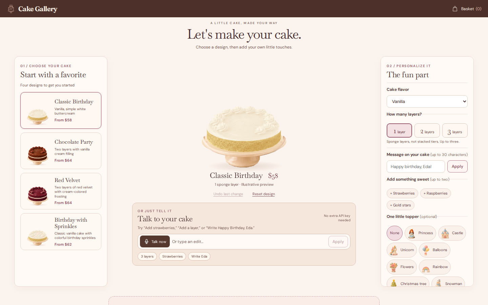
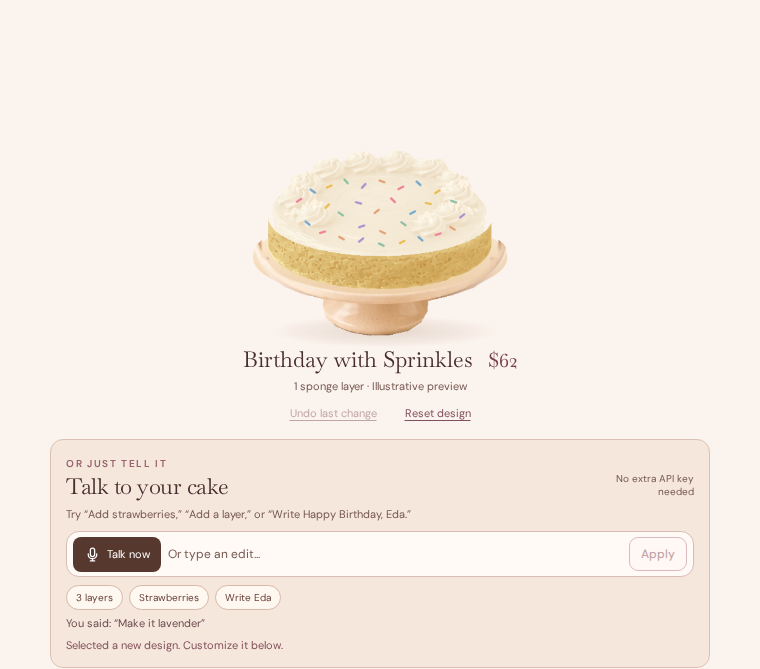
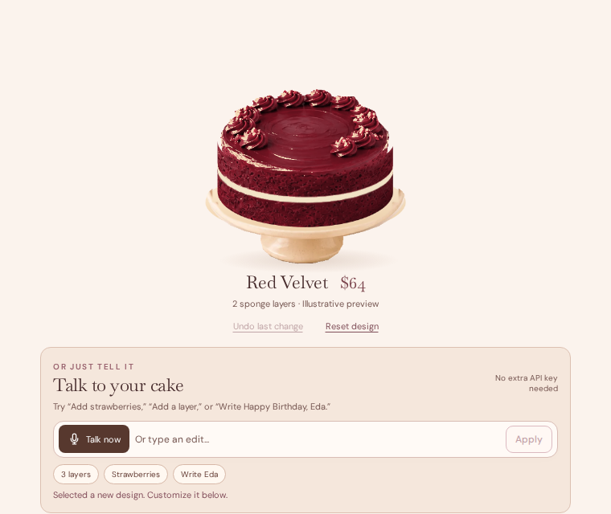
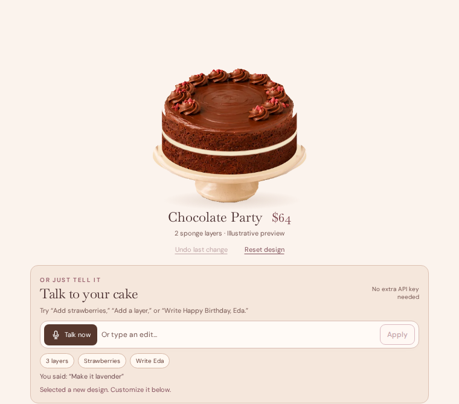
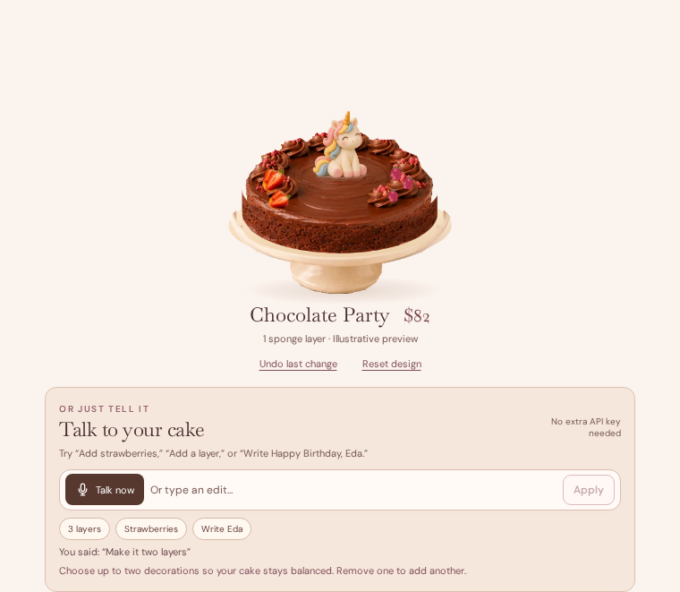

# Cake Gallery 🍰

A little cake, made your way.

Cake Gallery is a visual cake customizer for boutique bakeries. Pick a design that the bakery can make, add layers, decorations, candles, and a message, then save your cake to a basket. You can use the controls or simply tell the cake what to change.

Built as a small, low-cost prototype: **regular customization needs no AI API key or image generation**.

## A look inside

| Birthday with Sprinkles | Red Velvet |
|:---:|:---:|
|  |  |
| Chocolate Party | Add your own decorations |
|  |  |

*Screenshots from the working prototype. The cake images are illustrative, not bakery product photos.*

## How it works

1. **Pick a cake.** Start with one of four prepared designs.
2. **Make it yours.** Choose 1–3 sponge layers, flavor, decorations, a topper, candles, and a message.
3. **Talk or type.** Try “Add strawberries,” “Make it three layers,” or “Write Happy Birthday Eda.” You can also use the regular controls.
4. **Review the price.** See an updated estimate and save your design to a browser-local basket.
5. **Request something special.** Sculpted or unusually shaped cakes go into a custom quote draft instead of generating an inaccurate preview.

### The starter cakes

| Design | Starting price | Included |
|---|---:|---|
| Classic Birthday | $58 | One-layer vanilla cake |
| Chocolate Party | $64 | Two-layer chocolate cake with vanilla-colored cream filling |
| Red Velvet | $64 | Two-layer red velvet cake |
| Birthday with Sprinkles | $62 | One-layer vanilla cake with prepared colorful sprinkles |

Prices are examples for the NYC bakery prototype: **$58 base cake**, plus charges for extra layers, toppings, toppers, and candles. The price updates with each supported edit.

The default cake frosting is part of the prepared artwork. **There is no frosting color picker or artificial frosting recoloring.** The selectable toppings are strawberries, raspberries, and gold stars (up to two types). Birthday with Sprinkles includes its own prepared sprinkles. The topper menu includes birthday, holiday, and playful designs such as balloons, a castle, a unicorn, a Christmas tree, and a racing kart.

## Run it locally

You'll need **Node.js 22+**.

~~~bash
git clone https://github.com/edakturk14/cake-builder.git
cd cake-builder
npm ci
npm run dev
~~~

Open [http://127.0.0.1:5173](http://127.0.0.1:5173).

No `.env` file or API key is needed for the normal builder. The web app uses **React, TypeScript, and Vite**, with a small **Express** server.

### Useful commands

~~~bash
npm run typecheck
npm test
npm run build
~~~

## What's under the hood?

- `src/shared/bakery.ts` defines the starter cakes, available decorations, and bakery pricing.
- `src/shared/cake.ts` contains cake state, edit validation, Undo, and the underlying demo-pricing rules.
- `src/shared/localCommands.ts` interprets the supported spoken and typed cake edits without calling an LLM.
- `src/components/CakeScene.tsx` and `src/components/FruitDecorations.tsx` render the cake and prepared decorations.
- `tests/browser-smoke.mjs` checks the actual customer flow in Chromium.

The cake uses prepared images rather than generating a new image for every request. Browser speech recognition is optional and browser-dependent; typing and clicking always work. The legacy paid interpretation and image-generation endpoints are **disabled by default**. Do not expose them publicly without authentication and spending limits.

## Prototype limitations

This is **not a live bakery storefront** yet. The basket saves locally in the browser; there is no payment processing, order submission, stock management, or confirmed pickup/delivery scheduling. A complex custom-cake request is a copyable draft, **not a message sent to the baker**.

For the earlier voice-first experiments, see `docs/build-brief.md`, `docs/validation.md`, and `docs/retest-interpretation.md`.
